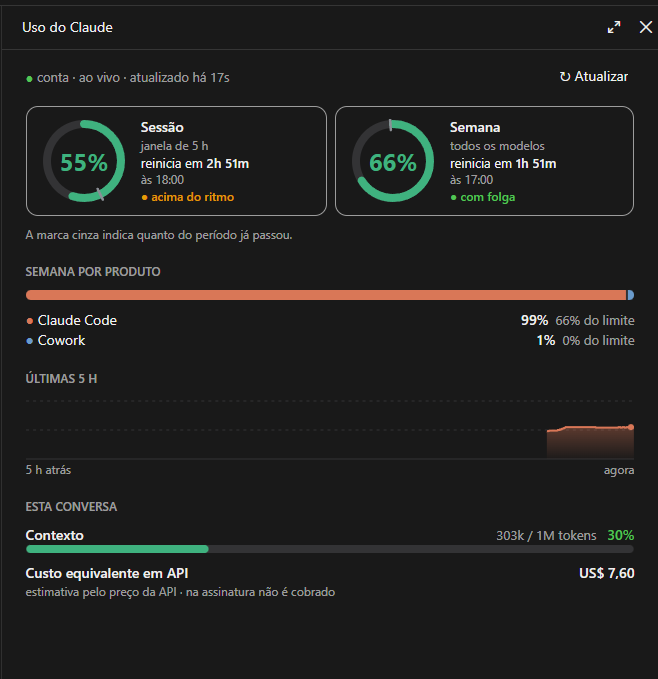

# Usage Monitor — uso do Claude ao vivo

Um mod para o Claude Code que mostra o uso do seu plano **ao lado do chat**, sem precisar abrir as configurações.

<p align="center"></p>

- **Painel** (fixo ao lado da conversa, ou como widget no app desktop) com todos os limites do plano:
  - Sessão atual (5 h), Semana (todos os modelos), Semana · Sonnet / Opus, e qualquer limite novo que a Anthropic adicionar
  - Quando cada um reinicia (“reinicia em 2h 14m”)
  - **Marcador de ritmo** na barra (`│`): mostra quanto do período já passou, então dá para ver na hora se você está acima ou abaixo do ritmo
  - **Projeção**: “no ritmo atual chega a 100% em ~1h05” quando o limite de 5 h vai estourar antes de reiniciar
  - Histórico das últimas 5 h em minigráfico
  - **Semana por produto**: quanto do uso semanal veio do Claude Code, dos chats, do Cowork etc.
  - Uso extra (créditos), quando ativado
  - **Quanto dá para usar**: ~% por dia na semana e ~% por hora na sessão
  - **Claude Code neste computador**: tokens, custo estimado e respostas de hoje e dos últimos 7 dias, somando todas as sessões
  - Contexto da conversa atual, tokens de entrada e saída, quanto veio do cache, e custo equivalente em API (estimativa)
- **Barra compacta** logo acima da caixa de mensagem: `◆ 5h ████░░┃░░░ 42% ↻ 2h 14m · 7d 19% · contexto 36%`
- **Alertas** ao passar de 80% e 95% (configurável), uma vez por período, com notificação do sistema no limite mais alto, e um aviso quando a sessão ou a semana reiniciam.

## De onde vêm os dados

1. **Da sua conta, ao vivo**: os mesmos números da página de uso nas configurações. O mod consulta a cada 60 s (configurável) usando a credencial da própria sessão — ela nunca passa pelo código do mod: o Claude Code entrega só um identificador opaco que funciona apenas nos servidores da Anthropic. Como é a conta inteira, conta também o uso no claude.ai e em outras sessões.
2. **Reserva**: se a consulta à conta falhar, o mod mostra os limites que a última resposta desta sessão informou, e avisa isso no painel.

Contexto e custo vêm sempre da sessão atual. O custo é uma **estimativa** pelo preço da API; numa assinatura Pro/Max o uso dentro do plano não é cobrado em dólares.

Os limites do plano só existem para login com assinatura (Pro, Max, Team). Com chave de API, o painel mostra só contexto e custo.

## Comandos

| Comando | O que faz |
| --- | --- |
| `/uso` | Abre o painel e escreve um resumo na conversa |
| `/uso atualizar` | Atualiza agora |
| `/uso barra` | Mostra ou oculta a barra acima da caixa de mensagem |
| `/uso debug` | Mostra a origem dos dados e a resposta bruta da conta |

Em inglês o comando é `/usage-monitor` (com `refresh`, `band`, `debug`).

## Opções

Em `/config` (ou em `pluginConfigs.usage-monitor.options` no `settings.json`):

| Opção | Padrão | |
| --- | --- | --- |
| `language` | `pt-BR` | `pt-BR` ou `en` |
| `refreshSeconds` | `60` | Intervalo de atualização (mínimo 30) |
| `showBand` | `true` | Barra acima da caixa de mensagem |
| `openPanelOnStart` | `true` | Abre o painel ao iniciar (no desktop, como widget) |
| `showStatusLine` | `false` | Resumo na linha de status |
| `alertThresholds` | `80,95` | Porcentagens que disparam alerta; vazio desliga |
| `desktopNotifications` | `true` | Notificação do sistema no limite mais alto |

## Instalação

Num terminal com o Claude Code:

```
/plugin install usage-monitor --marketplace jamilsalomao/claude-usage-monitor
```

Responda `y` para adicionar o marketplace e escolha o escopo **user** (Enter) para ele valer em todas as sessões.

Ou pelo shell: `claude plugin install usage-monitor --marketplace jamilsalomao/claude-usage-monitor`.

No app desktop: clique em **+** ao lado da caixa de mensagem → **Plugins** → **Add marketplace** com `jamilsalomao/claude-usage-monitor` → **Add plugin**.

## Desenvolvimento

```
claude plugin validate .
claude plugin test .
```

- `hooks/register.tsx` — ganchos, painel e barra
- `hooks/data.ts` — leitura da conta e da sessão, histórico e alertas
- `hooks/lib.ts` — funções puras (formatação, ritmo, projeção, orçamento, totais)
- `hooks/svg.ts` — anéis, barras e gráfico desenhados em SVG
- `hooks/i18n.ts` — textos em português e inglês
- `tests/usage.test.tsx` — testes em todas as superfícies

---

## English

Live Claude plan usage beside the chat: 5-hour session, weekly limits (all models, Sonnet, Opus, and any new one), reset countdowns, a pace marker, a projection of when you would hit 100%, a 5-hour history, extra usage, the context window and an estimated API-equivalent cost. Plus a one-line band above the prompt and threshold alerts. Set `language` to `en`; the command is then `/usage-monitor`. Figures come from your account's usage endpoint (the Settings → Usage numbers), with this session's last rate-limit reading as a fallback.

## Licença

MIT — veja [LICENSE](LICENSE).
